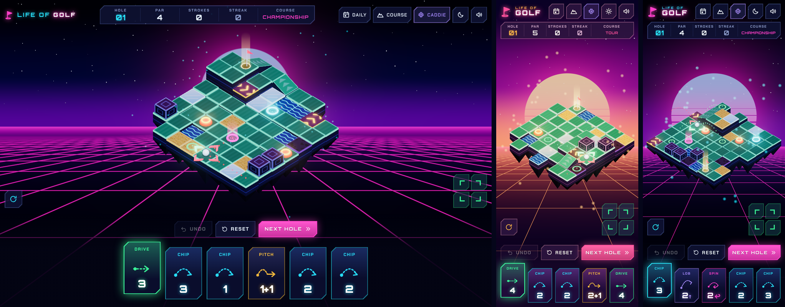

# Life of Golf

**[Play now on GitHub Pages](https://bradflaugher.github.io/life-of-golf/)**

<p align="center">
  
</p>

An infinite isometric 3D golf puzzle card game inspired by *Golf Peaks*, powered by a tiny on-device neural network (**`CaddieNet-v1`**, 3,746 parameters, 25 KB) running **100% locally in your browser** with zero servers and zero data collection.

---

## Features

- **Infinite BFS-Verified Holes:** Every procedurally generated course is verified solvable by an exact breadth-first solver with optimal par, shareable `?seed=...` URLs, and a shared **Daily Course** (`?daily=YYYY-MM-DD`).
- **4 Difficulty Presets + Custom Course Builder:** Play **Relaxed** (`5×5`), **Classic** (`6×6`), **Tour** (`7×7`), or **Championship** (`8×8`, 3-tier peaks) — or customize board size, elevation tiers, hand size, and toggle individual terrains.
- **10 Terrains & Mechanics:**
  - **Fairway & 3-Tier Cliffs** with angled **3D Ramps** (climb uphill, gain momentum downhill)
  - **Sand Bunkers** (stop rolling balls; escape with a Chip/Lob card)
  - **Water Hazards & Floating Island Cliffs**
  - **Frictionless Ice** (slide continuously until off ice or blocked)
  - **Sticky Mud / Deep Rough** (drains extra roll momentum)
  - **Stone Hedge Walls** (bank-shot rebounds!)
  - **Directional Boost / Wind Strips**
  - **Coral Spring Pads** (launch 2 tiles over walls and water)
  - **Twin Warp Portals** (preserve roll momentum across the island)
- **5 Shot Card Types:** Putt/Roll (`1–4`), Chip (`1–3`), Pitch (`1+1`, `2+1`, `1+2`), Backspin (`2↩`, `3↩`), and Super Lob (`2↑`).
- **Mobile-First Controls:** The course fills the whole screen and the HUD floats over it. Tap a card in the bottom thumb-zone hand, then **swipe anywhere**, **tap a glowing chevron**, **tap the tile the shot lands on**, or use the **diagonal pad** (one button per isometric direction). Every direction previews its dotted flight path and landing ring. Landscape phones get the hand as a side rail. Full keyboard support (`1–7`, Arrows/WASD, `Z` undo, `R` reset, `Q/E` rotate 90°, `H` AI Caddie).
- **🧠 CaddieNet-v1 (On-Device Edge AI):** A compact `24 → 64 → 32 → 2` Policy+Value MLP trained on BFS-solved holes (`scripts/train_caddie.mjs`). Runs real `Float32Array` forward passes in `< 1 ms` per board to display live move softmax probabilities, raw logits (`z`), predicted strokes-to-cup `V(s)`, and 32 hidden-layer ReLU activations.
- **Neon-Noir Look, Two Palettes:** **Midnight Links** (navy, cyan and magenta) and **Sunset Drive** (plum sky, molten sun). A shader backdrop with a striped sun, twinkling stars and a scrolling horizon grid; glowing tile edges, light beacons on the cup and portals, a comet trail on the ball and bloom, which steps down by itself on slow devices (`?fx=low` or `?fx=high` forces it). Self-hosted Orbitron and Chakra Petch type (SIL OFL, `src/fonts/`), inline SVG icons, synthesized Web Audio effects and light haptics.

---

## Local Development & Testing

```bash
node --test tests/*.test.mjs             # Run physics, BFS generator, CaddieNet & UI wiring tests
node scripts/train_caddie.mjs            # Retrain CaddieNet-v1 weights (models/caddie_net.json)
python3 -m http.server 8765              # Serve locally at http://127.0.0.1:8765
```
